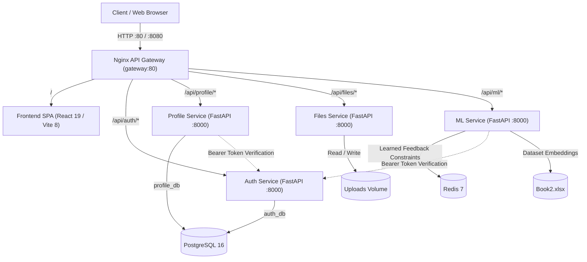

# CareerLens 🎯

An AI-powered internship recommendation and career tools platform that helps students find the best-fit internships, build ATS-optimized resumes, and evaluate application strength.

CareerLens is architected as a cloud-native, microservices-based application running behind an Nginx API Gateway with containerized backend services, PostgreSQL, Redis, and a React 19 Single Page Application.

---

## Architecture



---

## Services Overview

| Service | Directory | Internal Port | Gateway Path Prefix | Description | Tech Stack / Dependencies |
|---|---|---|---|---|---|
| **API Gateway** | [`gateway/`](file:///gateway) | `80` | `/`, `/gateway-health` | Reverse proxy, request routing, static frontend proxying, timeout configuration | Nginx (Alpine) |
| **Frontend** | [`frontend/`](file:///frontend) | `80` | `/` | User interface: dashboard, resume builder, ATS evaluation, recommendations | React 19, Vite 8, React Router v7, Lucide |
| **Auth Service** | [`services/auth/`](file:///services/auth) | `8000` | `/api/auth/*` | User registration, login, Argon2 password hashing, HS256 JWT issuance | FastAPI, SQLAlchemy 2, PostgreSQL (`auth_db`), Argon2 |
| **Profile Service** | [`services/profile/`](file:///services/profile) | `8000` | `/api/profile/*` | User profile storage, education, skills, achievements, drafts | FastAPI, SQLAlchemy 2, PostgreSQL (`profile_db`), JWT Auth |
| **Files Service** | [`services/files/`](file:///services/files) | `8000` | `/api/files/*` | Resume and document uploads, PDF text extraction, static file serving | FastAPI, PyPDF2, StaticFiles, Volume Mount |
| **ML Service** | [`services/ml/`](file:///services/ml) | `8000` | `/api/ml/*` | Semantic internship recommendations, ATS scoring, adaptive feedback loop | FastAPI, PyTorch, Sentence-BERT (`all-MiniLM-L6-v2`), Redis 7 |
| **PostgreSQL** | — | `5432` | Internal | Relational database hosting `auth_db` and `profile_db` schemas | PostgreSQL 16 Alpine |
| **Redis** | — | `6379` | Internal | Fast key-value store caching user dislike constraints and feedback | Redis 7 Alpine |

---

## Project Structure

```
├── .github/
│   └── workflows/
│       └── ci.yml             # GitHub Actions CI workflow (PR tests & lint, main GHCR push)
├── frontend/                  # React 19 + Vite 8 SPA
│   ├── src/
│   │   ├── pages/             # Login, Signup, Dashboard, ProfileSetup, Recommendations, etc.
│   │   ├── components/        # Navbar, InternshipCard, ResumeTemplate, FeedbackModal
│   │   ├── api/               # Centralized API client (points to /api/*)
│   │   ├── App.jsx
│   │   └── main.jsx
│   ├── Dockerfile
│   └── package.json
├── gateway/                   # Nginx reverse proxy API gateway
│   ├── nginx.conf
│   └── Dockerfile
├── services/                  # Microservices
│   ├── auth/                  # User authentication & JWT service
│   ├── profile/               # Student profile persistence service
│   ├── files/                 # Document upload and PDF extraction service
│   ├── ml/                    # Sentence-BERT recommendation and ATS evaluation service
│   └── common/                # Shared utilities (JWT token verification dependency)
├── k8s/                       # Kubernetes manifests (Kustomize)
│   ├── kind-cluster.yaml      # Kind cluster configuration with port mappings
│   ├── base/                  # Base Kubernetes Deployments, Services, ConfigMaps, Ingress
│   └── overlays/dev/          # Local development overlay
├── data/
│   └── Book2.xlsx             # Internship dataset
├── scripts/
│   ├── smoke.py               # Automated end-to-end smoke test script
│   └── smoke.sh               # Shell wrapper for smoke testing
├── legacy-backend/            # Archived original FastAPI monolith (reference only)
├── docker-compose.yml         # Local multi-service orchestration
└── Makefile                   # Quick commands for Compose and smoke tests
```

---

## Running with Docker Compose

Docker Compose is the recommended way to spin up the entire application stack locally.

### 1. Prerequisites
- [Docker](https://docs.docker.com/get-docker/) & [Docker Compose](https://docs.docker.com/compose/) installed
- Python >= 3.11 (for running tests/smoke tests locally)

### 2. Configure Environment
Copy the example environment file:
```bash
cp .env.example .env
```
Ensure `JWT_SECRET` (minimum 32 characters) and database passwords are set.

### 3. Build & Start the Services
```bash
# Build and start all containers in detached mode
docker compose up --build -d

# Or using Makefile
make up
```

### 4. Check Status & Health
```bash
docker compose ps
curl -i http://localhost/gateway-health
```

### 5. Run the Automated Smoke Test Suite
The smoke test verifies end-to-end integration across all microservices (health checks, user registration, JWT authentication, profile creation, and ML recommendations):
```bash
# Run using Python
python scripts/smoke.py

# Or using bash / Makefile
bash scripts/smoke.sh
# or: make smoke
```

### 6. Access the Application
- **Frontend SPA**: `http://localhost`
- **Gateway Health Check**: `http://localhost/gateway-health`
- **Auth Health**: `http://localhost/api/auth/health`
- **Profile Health**: `http://localhost/api/profile/health`
- **Files Health**: `http://localhost/api/files/health`
- **ML Health**: `http://localhost/api/ml/health`

### 7. Stop the Services
```bash
docker compose down

# Or stop and remove volumes
docker compose down -v
# or: make clean
```

---

## Running on Kubernetes (Kind + Kustomize)

The repository provides production-structured Kubernetes manifests managed via **Kustomize** (`base/` + `overlays/dev/`) tested on **kind** (Kubernetes in Docker).

### 1. Prerequisites
- [Docker](https://www.docker.com/) running
- [kind](https://kind.sigs.k8s.io/) (`kind version`)
- [kubectl](https://kubernetes.io/docs/tasks/tools/) (`kubectl version --client`)

### 2. Create the Kind Cluster
```bash
kind create cluster --config k8s/kind-cluster.yaml
```

### 3. Deploy NGINX Ingress Controller
```bash
kubectl apply -f https://raw.githubusercontent.com/kubernetes/ingress-nginx/main/deploy/static/provider/kind/deploy.yaml

# Wait for Ingress Controller to become ready
kubectl wait --namespace ingress-nginx \
  --for=condition=ready pod \
  --selector=app.kubernetes.io/component=controller \
  --timeout=180s
```

### 4. Build Images & Load into Kind
```bash
# Build images
docker build -t careerlens-auth:latest ./services/auth
docker build -t careerlens-profile:latest ./services/profile
docker build -t careerlens-files:latest ./services/files
docker build -t careerlens-ml:latest ./services/ml
docker build -t careerlens-frontend:latest ./frontend

# Load into the kind cluster
kind load docker-image careerlens-auth:latest --name careerlens-cluster
kind load docker-image careerlens-profile:latest --name careerlens-cluster
kind load docker-image careerlens-files:latest --name careerlens-cluster
kind load docker-image careerlens-ml:latest --name careerlens-cluster
kind load docker-image careerlens-frontend:latest --name careerlens-cluster
```

### 5. Deploy with Kustomize
```bash
kubectl apply -k k8s/overlays/dev
```

Wait for rollouts to finish:
```bash
kubectl rollout status statefulset/postgres --timeout=120s
kubectl rollout status deployment/redis --timeout=120s
kubectl rollout status deployment/auth --timeout=120s
kubectl rollout status deployment/profile --timeout=120s
kubectl rollout status deployment/files --timeout=120s
kubectl rollout status deployment/ml --timeout=300s
kubectl rollout status deployment/frontend --timeout=120s
```

### 6. Run Smoke Tests Against the Cluster
```bash
# Direct smoke test against ingress on localhost port 80
SKIP_COMPOSE=true GATEWAY_URL="http://localhost" python scripts/smoke.py
```

### 7. Delete the Kind Cluster
```bash
kind delete cluster --name careerlens-cluster
```

---

## API Reference

All requests pass through the API Gateway at `http://localhost/` (or Ingress on Kubernetes).

### Gateway Endpoints
| Method | Endpoint | Description |
|---|---|---|
| `GET` | `/gateway-health` | Gateway health check probe (returns `{"status":"ok","service":"gateway"}`) |
| `GET` | `/` | Serves the React Single Page Application |

### Auth Service (`/api/auth/*`)
| Method | Endpoint | Auth | Description |
|---|---|---|---|
| `GET` | `/api/auth/health` | None | Auth service health status |
| `POST` | `/api/auth/signup` | None | Register new user. Body: `{"full_name", "email", "password"}` |
| `POST` | `/api/auth/login` | None | Authenticate user. Body: `{"email", "password"}`. Returns JWT `access_token` |
| `GET` | `/api/auth/me` | Bearer Token | Return authenticated user details |

### Profile Service (`/api/profile/*`)
| Method | Endpoint | Auth | Description |
|---|---|---|---|
| `GET` | `/api/profile/health` | None | Profile service health status |
| `GET` | `/api/profile/{user_id}` | Bearer Token | Retrieve student profile (education, skills, drafts, liked items) |
| `POST` | `/api/profile/{user_id}` | Bearer Token | Create or update student profile data |

### Files Service (`/api/files/*`)
| Method | Endpoint | Auth | Description |
|---|---|---|---|
| `GET` | `/api/files/health` | None | Files service health status |
| `POST` | `/api/files/upload` | None | Upload resume PDF or image (multipart/form-data `file`). Returns public URL |
| `POST` | `/api/files/extract_pdf` | None | Extract text from uploaded PDF document |
| `GET` | `/api/files/uploads/{filename}` | None | Serve uploaded document or certificate |

### ML Recommendation & ATS Service (`/api/ml/*`)
| Method | Endpoint | Auth | Description |
|---|---|---|---|
| `GET` | `/api/ml/health` | None | ML service health status |
| `POST` | `/api/ml/recommend` | Bearer Token | Top-N internship recommendations using Sentence-BERT cosine similarity and learned feedback constraints |
| `POST` | `/api/ml/feedback` | Bearer Token | Submit dislike feedback with reason to adapt future recommendations |
| `POST` | `/api/ml/evaluate_ats` | None | Run ATS scoring: hybrid semantic + keyword score of resume against internship |
| `POST` | `/api/ml/enhance_profile` | None | Run offline resume enhancer (categorize skills, bullet action verbs) |
| `GET` | `/api/ml/internships/light` | None | Retrieve lightweight list of internships (`internship_id`, `title`) |

---

## Recommendation & ATS Mechanics

### Recommendation Engine
1. Combines user profile skills, education, achievements, and resume text into a unified representation.
2. Encodes the text into a 384-dimensional dense vector with **Sentence-BERT** (`all-MiniLM-L6-v2`).
3. Computes cosine similarity scores against precomputed embeddings of internships in `data/Book2.xlsx`.
4. Filters out internships that violate user dislike constraints (e.g., excluded locations, stipend minimums, negative domains) retrieved from Redis.
5. Returns top-scoring matches ordered by relevance.

### ATS Scoring Formula
The ATS evaluator evaluates a resume against an internship using a weighted dual signal:
- **Semantic Score (60%)** — Cosine similarity between resume embedding and internship description embedding.
- **Keyword Match Score (40%)** — Percentage of essential skill keywords extracted from the internship present in the resume text.

$$\text{Final ATS Score} = ((\text{Semantic Similarity} \times 0.6) + (\text{Keyword Match Rate} \times 0.4)) \times 100$$

---

## Continuous Integration (CI)

A GitHub Actions workflow is defined in [`.github/workflows/ci.yml`](file:///.github/workflows/ci.yml):
- **On Pull Request**:
  - Runs automated pytest test suites for each backend service (`auth`, `profile`, `files`, `ml`) with PostgreSQL and Redis service containers.
  - Runs `npm ci`, `npm run lint`, and `npm run build` on the `frontend`.
  - Performs `docker build` validation for each container image (`auth`, `profile`, `files`, `ml`, `frontend`, `gateway`).
- **On Push to `main`**:
  - Builds and publishes container images to **GitHub Container Registry (GHCR)** tagged with the commit SHA and `:latest`.

---

## Legacy Monolith

The original monolithic FastAPI application has been archived into [`legacy-backend/`](file:///legacy-backend) for reference. All ongoing development and deployment targets the microservices in `services/`, `gateway/`, and `frontend/`.
